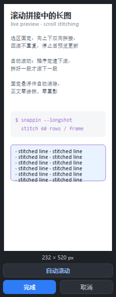
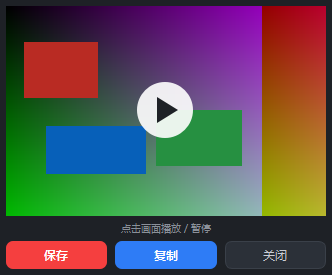

# SnapPin — PixPin 风格截图贴图工具（开源复刻）

Python + PySide6 实现的 PixPin 核心功能复刻：**截图 / 贴图 / OCR 取字 / 翻译 / 长截图 / GIF 录制 / Ditto 式剪贴板历史 / 密码管理**。
纯从零实现，未使用任何 PixPin 反编译产物；OCR 走 **PixPin 式三段管线**（检测 → 裁块 → 超分 → 识别，
PaddleOCR ONNX 模型 + onnxruntime 进程内推理，缺依赖时自动回退 RapidOCR-json），
翻译支持免 Key 在线直连 / GLM / MiniMax / 自定义 OpenAI 兼容 API / 本地离线引擎。

## 下载（Windows）

到 [Releases](https://github.com/shihenglong/SnapPin/releases/latest) 下载
`SnapPin-x.y.z-windows-x64.zip`（标准版）或 `SnapPin-x.y.z-full-windows-x64.zip`
（full 版，内置离线翻译插件），解压后运行 `SnapPin.exe`（免安装，绿色版）。

- 仅支持 Windows 10/11 x64。
- **升级方式**：下载新 zip 直接覆盖解压即可。所有用户数据（配置 / 剪贴板历史 /
  密码库 / 缓存）都存放在 `%APPDATA%\SnapPin`，与程序目录完全分离，替换程序不会丢数据。
- 应用内置**自动检查更新**（GitHub Releases），也可在 设置 → 关于 手动检查。

## 界面预览

| 截图与标注（选区工具栏 / 箭头 / 尺寸提示） | 贴图取字（OCR 高亮，选中字符即复制） |
|---|---|
|  |  |
| **右键翻译：译文直接替换原图文字** | **剪贴板历史（Ditto 式快贴，点哪行粘哪行）** |
|  |  |
| **长截图预览（双向拼接 / 自动滚动 / 实时刷新）** | **GIF 录制结果（钉在桌面，点击播放）** |
|  |  |

设置窗口（8 页导航 · 应用/确定/取消 统一提交 · 关于页可检查更新）：


## 长截图（滚动拼接）

- **双向拼接**：向下滚自动追加新内容，向上滚把上方新内容前插到长图头部；
  已捕获的行永不改写，来回滚动零重复、零覆盖。
- **自动滚动**：预览窗点「自动滚动」，程序每 400ms 检查一次、**拼好一段才滚下一段**；
  连续四拍没有新内容即判定到底并停止。
- **背景解锁**：进入长截图后覆盖层只保留选区边框与工具栏，选区外恢复实时桌面，滚动时四周无割裂感。
- **位移匹配（PixPin 原样复刻）**：每帧先出「匹配结果」再驱动拼接——灰度化 → 横向压到 **32 px**
  （`INTER_AREA`）→ 纵向 `boxFilter` **1×15** 平滑，用**汉明距离**做逐行最近邻，再对
  `Δ = trainIdx − queryIdx` **投票**取冠军；单候选误差阈值 `≤ max(30, 2×最小距离)`，
  置信度 `(top−runner2nd)/(top+2nd)` 必须 **≥ 0.5**，否则判「没匹配上」。
  搜索范围限定在 `[上次位移−block, 上次位移+2×block]`（滚动速度连续）。
- **对不上就跳过**：`status 2`（未匹配）整帧丢弃、`status 1`（到底）停手——PixPin 没有任何
  「硬衔接」或兜底拼接；预览窗状态栏显示「拒绝 N 帧」。
- **保存与贴图**：工具栏「保存」弹另存为对话框；「贴图」把长图直接钉到桌面（自动缩放适配屏幕）。

### 与 PixPin 实测实现的对齐表

逆向 `QLongScreenShot`(`0x1400C7370`)、匹配器 `findOffset`(`0x1400CE530`)、
`compose`(`0x1400CDFB0`/`0x1400CDA00`)，按地址级证据逐条复刻（引擎在 `longshot_pixpin.py`）：

| 维度 | PixPin（实测） | 本项目 | 对齐 |
|---|---|---|---|
| 行投影 | 灰度 → 宽 **32** `INTER_AREA` → `boxFilter` **1×15** | 同 | ✅ 完全一致 |
| 匹配器 | `cv::BFMatcher(NORM_HAMMING)`，`knnMatch(k=1)` | `np.bitwise_count` 逐行汉明距离，取 argmin | ✅ 等价 |
| 单候选阈值 | `distance ≤ max(30.0, 2×全体最小距离)` | 同 | ✅ 一致 |
| 投票 | `unordered_map<int,int>`，Δ = trainIdx − queryIdx | `np.unique` 计数 | ✅ 等价 |
| 接受判据 | 唯一候选→1.0；否则 `(top−2nd)/(top+2nd) ≥ 0.5` | 同 | ✅ 一致 |
| 搜索窗口 | `[上次位移−block, 上次位移+2×block)` | 同（首帧退化全量程，见注） | ✅ 一致 |
| 绝对位移 | 窗口起点 + Δ，负值截 0，写回作下帧锚点 | 同 | ✅ 一致 |
| 失败码 | 1 = 到底 / 2 = 未匹配 | `ERR_BOTTOM` / `ERR_NO_MATCH` | ✅ 一致 |
| 横向 | `cv::rotate` 90° 顺时针 → 复用纵向 → 逆时针转回 | `np.rot90(k=-1)` / `k=1` | ✅ 一致 |
| 抓帧周期 | `QTimer::start(timer, 100)` | `FRAME_INTERVAL_MS = 100` | ✅ 一致 |
| 拼接 | 逐行 `memcpy` 到 `r+offset` 行；每帧新建 QImage 全拷贝 | 同语义（按 offset 对齐、重叠被覆盖、无显式去重），只写新增段 | ⚠️ 语义一致、省掉 O(n²) 拷贝 |
| 固定件 | 无专门处理（投票淹没 Δ=0 的票） | 同 | ✅ 一致 |
| 滚动驱动 | **只监听**真实滚轮（`WH_MOUSE_LL` 只画箭头），**不注入** | 另加可选**主动注入**自动滚动（`mouse_event`） | ⬆️ 本项目的额外能力 |

**未照搬的两处**（都有明确理由）：

1. `m_ref.rows < 3×block` 时 PixPin 会 `goto LAB_1400ce69a`（该分支语义未确证），照抄会导致
   **第二帧永远无法匹配**；这里退化为全量程搜索。
2. 拼接起点 PixPin 是 `(dst.rows−offset)/2`，但报告已注明 `offset` 的绝对/相对语义未核实
   （且尺寸不自洽会 `exit(-1)`）。这里按语义实现（按绝对位移对齐写入）。

**继承自 PixPin 的已知限制**：窗口内搜索意味着「一步跳出窗口」（拖滚动条跳很远）那一拍
匹配不上，只能等滚回窗口内；且跳滚后的第一拍可能落在错误位置（窗口外内容它看不到）。
这是 PixPin 的固有限制，不是实现偏差。

注：`cv::matchTemplate` 的符号确实在 PixPin 静态链接的 OpenCV 里，但长截图链路**没有调用它**
（字符串表与 RTTI 中不存在该函数名），实际是「逐行签名 + 汉明距离 + 位移投票」。

## OCR（PixPin 式三段管线）

逆向 PixPin 的 `OcrRunnable` / `OcrTextItemLayer` 后按同样的结构实现
（`ocr_engine.py`；原 RapidOCR-json 黑盒路径保留为回退，缺依赖时自动生效）：

| 阶段 | 本项目实现 | 与 PixPin 的一致处 |
|---|---|---|
| 检测 | `ch_PP-OCRv4_det` ONNX，长边限幅 + 两边对齐 32 | 二值化阈值 0.3；**ImageNet 均值方差归一化**（实测常量 mean{0.485,0.456,0.406}、norm{1/58.395,1/57.12,1/57.375}，即 `(x-mean)/std`） |
| 超分 | 小字块（高 <24px）放大后再识别 | PixPin 编译进了 sr 超分网（224→448），但在两条 OCR 链路上都没找到 forward 调用；这一阶段是本项目的补强 |
| 识别 | `rec_ch_PP-OCRv4` ONNX，高 48、宽按宽高比自适应 | CTC 贪心解码：argmax → 跳 blank(0) → 去重复 → `cls-1` 查字典 → 置信度取各步最大概率均值 |
| 结果 | 四角坐标 + 文本 + 置信度 | 同构（PixPin 是 0x30 字节/条的数组） |
| 交互 | 可选中文字框，选字用**字符索引区间** | 同构（PixPin 也是字符区间 + 四边形上二分定位，无逐字符 bbox） |
| 线程 | QThread + 跨线程信号 | PixPin 用 QThreadPool + QRunnable，同为异步 |

两处**有意的性能改进**（PixPin 的实现特征，而非照搬）：模型 session 进程内缓存
（PixPin 每次 OCR 都从资源重新加载两套 ncnn 模型）、识别按宽度分桶批推理
（PixPin 逐框单张）。

参数校准依据（合成图 10 行 × 混合字号，字符相似度）：

| 检测归一化 | 平均相似度 |
|---|---|
| `(x/255-0.5)/0.5`（改造前） | 0.971 |
| ImageNet 均值方差（**采用**） | **0.987** |

## GIF 录制

- **工具栏 GIF 按钮**：选区固定、背景解锁，10fps 录制，最长 30 秒 / 300 帧。
- **鼠标指针入镜**：按真实鼠标位置叠加指针；左键点击带**扩散水波纹**
  （低级鼠标钩子捕获，快速点击也不会漏）。
- **结果预览钉在桌面**：默认不播放，画面上覆盖播放按钮层，点击开始播放 / 暂停；预览窗可拖动移动。
- **保存 / 复制 / 关闭**：保存弹另存为对话框；复制自动存入 `图片\SnapPin` 并把文件放进剪贴板；
  两者完成后自动关闭预览窗。
- **颜色**：全局 256 色调色板按原始像素采样 + MAXCOVERAGE 分配配额，
  实测与原画面平均色差 0.55/255。

## 从源码运行

```bash
pip install PySide6 numpy pillow onnxruntime opencv-python-headless
# pillow：GIF 编码；onnxruntime + opencv：OCR 三段管线（缺失时自动回退 RapidOCR-json）
python main.py        # 常驻托盘；开机自启可在设置里开
```

调试模式（输出工具栏坐标/OCR 过程）：

```bash
SNAPPIN_DEBUG=1 python main.py > snappin.log 2>&1
```

## 快捷键（与 PixPin 一致，可在设置中改）

| 快捷键 | 功能 |
|---|---|
| Ctrl+1 | 截图 |
| Ctrl+Alt+V | 剪贴板贴图 |
| Alt+2 | 关闭所有贴图 |
| Ctrl+Shift+2 | 隐藏/显示所有贴图 |
| Alt+V | 剪贴板历史（Ditto 式快贴） |

所有热键集中在 设置 → 快捷键，按「截图与贴图」「剪贴板」分组修改，保存后立即生效。

## 翻译

参考 evan-ocr 的双轨方案；贴图右键「翻译（替换原图）」渲染仍为本项目实现。
全部文字块并发批量翻译，完成时 toast 以浅灰小字显示耗时：

- **在线直连（默认，免 Key 免配置）**：Google GTX 直连 + MyMemory 多通道容灾，逐块并发；
  双通道都拿不到的块自动转离线插件补齐，开箱即用。
- **Ollama（本地大模型）**：自动连接本机 Ollama（`http://localhost:11434`），
  模型自动检测（Qwen / DeepSeek 优先），0 联网请求；不可用自动转离线插件。
- **GLM API（智谱）**：`https://open.bigmodel.cn/api/paas/v4` · `glm-4.7-flash`，填 Key 即用，一次请求批量。
- **MiniMax API**：`https://api.minimaxi.com/v1` · `MiniMax-M2`。
- **自定义**：任意 OpenAI 兼容 `/chat/completions` 端点。
- **离线插件（神经翻译）**：CTranslate2 + OPUS-MT int8 模型，零网络零密钥，CPU 单批 <0.5s。
  **full 版安装包已内置**；标准版在 设置 → 翻译 → 离线插件 点「下载」（约 107MB，
  引擎包 39.7MB + en-zh 模型包 67MB），或手动解压插件包到 `vendor/plugins/translation/`。
- 目标语言支持 简体中文 / English / 日本語；所有引擎失败时最终兜底离线插件，保证可用。

## 剪贴板历史（Ditto 风格）

- **自动记录**：复制即记录，文本 / 图片 / 文件 / HTML 等所有可复制类型（保存全部剪贴板格式原始数据）。
- **快贴窗口**（`Alt+V` 或托盘菜单，Ditto 布局）：编号列表 + 底部搜索 + ••• 菜单（刷新/清空/设置）；
  **单击条目 = 粘贴**到目标窗口；右侧工具栏：✕ 关闭（Esc 同）、🔒 锁定（锁定后粘贴不关窗、
  失焦不隐藏，双击侧栏空白处同样可切换）、📌 只看常用项、🔑 密码库列表，点按切换。
- **键盘流**：输入即过滤 · `↓` 进列表 · `Enter` 粘贴当前行（密码行默认贴密码）·
  `Del` 删除 · `1`-`9` 快贴对应编号行 · `Esc` 关闭。
- **常用项**：右键「设为常用」📌 置顶且永不被清理；右键可直接删除或仅复制不粘贴。
- **密码快贴**：侧栏 🔑 列出全部条目，或在搜索框直接输入名称/账号，命中后显示「账号 / 密码」两行，
  **点哪行粘哪行**；密码默认掩码（右键「显示密码」），不会进入剪贴板历史，
  粘贴 30 秒后自动清空剪贴板。
- **存储**：SQLite（默认 `%APPDATA%\SnapPin\clip.db`，路径可在设置改）；保留天数（默认 7 天）
  与最大条数（默认 500）均可在设置调整；密码管理窗口复制的密码不会进入历史。
- **局域网同步（Ditto「朋友」式）**：设置 → 剪贴板 → 局域网同步，填好友 IP/计算机名（逗号分隔）
  与两端一致的网络密码后，本机复制的条目自动发给好友，好友复制的自动进本机剪贴板与历史；
  只接收好友列表内机器、密码校验只传哈希；文件类条目只同步路径引用，不传文件内容。

## 密码管理

- 名称 / 账号 / 密码三字段，手动增删改查；双击表格行快速复制密码。
- **在剪贴板历史窗口（Alt+V）搜索名称即可快贴**：账号 / 密码两行，点哪行粘哪行。
- 密码字段用 Windows DPAPI 加密（仅本机当前用户可解密），复制密码 30 秒后自动清空剪贴板。
- 数据库路径可在设置更改（默认 `%APPDATA%\SnapPin\pw.db`），保存后立即生效；
  保存/删除失败会弹窗提示，不会再无声失败。

## 交互（对齐 PixPin 实测行为）

- **截图**：全屏暗化 + 窗口吸附（跳过鼠标穿透层）+ 尺寸提示条；拖拽框选或单击选中窗口；
  选区 8 锚点可调、可拖动。
- **选区工具栏**：矩形/直线/箭头/椭圆/画笔/马克笔/颜色/马赛克/文字/橡皮擦 | 撤销/重做 |
  贴图/GIF 录制/关闭/保存/复制。
- **标注颜色**：色板红色、绿色居前；画完一个形状后点色板，**刚画的形状立即换色**，
  所选颜色自动记忆为下次默认。
- **完成**：双击选区内外任意处 → 退出并自动进剪贴板（PixPin 行为）；Enter=复制；
  Ctrl+D=直接贴图；Esc=取消。
- **贴图即取字**：钉上后自动 OCR 全图，文字块淡蓝高亮，悬停加深，**点击文字块直接复制**；
  Shift+拖拽可重选识别区域。
- **右键翻译**：右键贴图 →「翻译（替换原图）」→ 译文直接渲染替换原图文字块（自动取背景色/
  自适应字号），即"P成中文"；「显示原文」一键切回。另有复制全部文字/复制贴图/保存/缩放/
  透明度/关闭所有贴图。
- **贴图窗口**：拖动移动、滚轮缩放（Ctrl+滚轮调透明度）、投影阴影、置顶。
- **托盘单击**：默认打开设置（可在设置改回截图/贴图）。
- **设置窗口**：左侧导航（通用/截图/贴图/剪贴板/密码管理/翻译/快捷键/关于），
  底部「应用 / 确定 / 取消」统一提交，直接关闭窗口 = 丢弃改动。

## 发布（维护者）

```bash
python -m PyInstaller --noconfirm snappin.spec        # 构建 exe
python tools/make_release_zip.py                       # 标准版 zip
python tools/make_release_zip.py --full                # full 版 zip（内置离线翻译）
python tools/publish_release.py --version 0.6.0 \
       --notes build/release_notes_v0.6.0.md dist/*.zip   # 建 Release + 传资产
```

发布脚本的令牌取自 git 凭据（能 push 就能发），支持断点续传与大文件重试。

## 目录结构

```
SnapPin/
├── main.py           # 入口：单实例、托盘、热键接线、启动检查更新
├── version.py        # 版本号 + 仓库地址（发布时改）
├── updater.py        # 检查更新（GitHub Releases API）
├── capture.py        # 截图覆盖层 + 工具栏 + 标注 + 长截图 + GIF 录制
├── pinwin.py         # 贴图窗口（取字/翻译替换）
├── ocr.py            # OCR 调度：进程内三段管线优先，RapidOCR-json 回退
├── ocr_engine.py     # PixPin 式 OCR 管线：检测→裁块→超分→识别（onnxruntime + opencv）
├── translate.py      # 翻译：免 Key 直连/GLM/MiniMax/自定义 API + 本地离线引擎（批量）
├── hotkeys.py        # RegisterHotKey 全局热键线程
├── settings_ui.py    # 设置窗口（导航 + 卡片 + 确定应用取消 + 检查更新）
├── config.py         # 配置持久化（%APPDATA%\SnapPin）
├── icons.py          # 手绘 SVG 线性图标（无第三方资源）
├── clip.py           # 剪贴板监听 + SQLite 历史（全部格式）
├── clipwin.py        # Ditto 式快贴窗口
├── pwman.py          # 密码库（DPAPI 加密）
├── pwmanwin.py       # 密码管理窗口
└── vendor/plugins/   # RapidOCR-json 引擎 + 翻译引擎（发布时随包）
    ├── ocr/
    └── translation/
```

## 已知边界（MVP）

- 多屏未支持（当前取光标所在屏）；标注工具未逐一视觉回归。
- 贴图重启恢复（启动时恢复未关闭的贴图）未实现。
- 本地翻译引擎为词典型（逐词替换），追求质量请配置 GLM / MiniMax API。

## 协议

[MIT](LICENSE)
