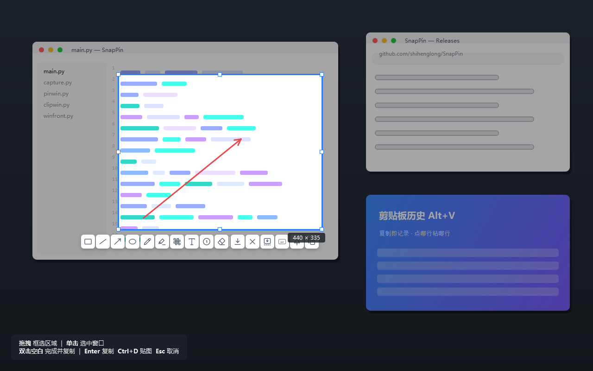
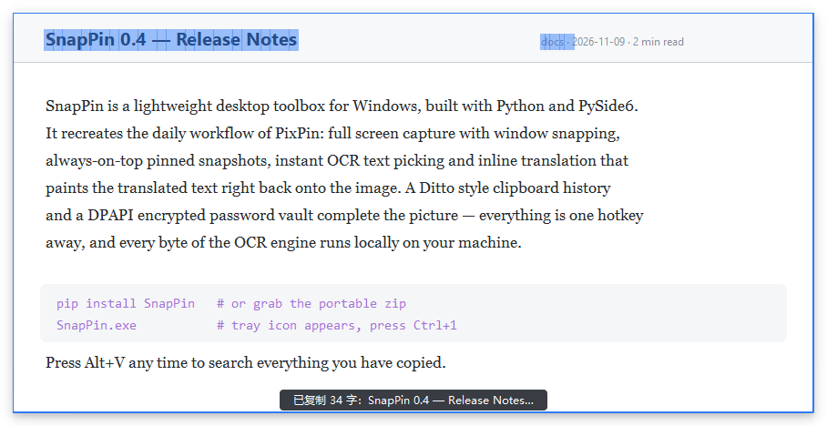
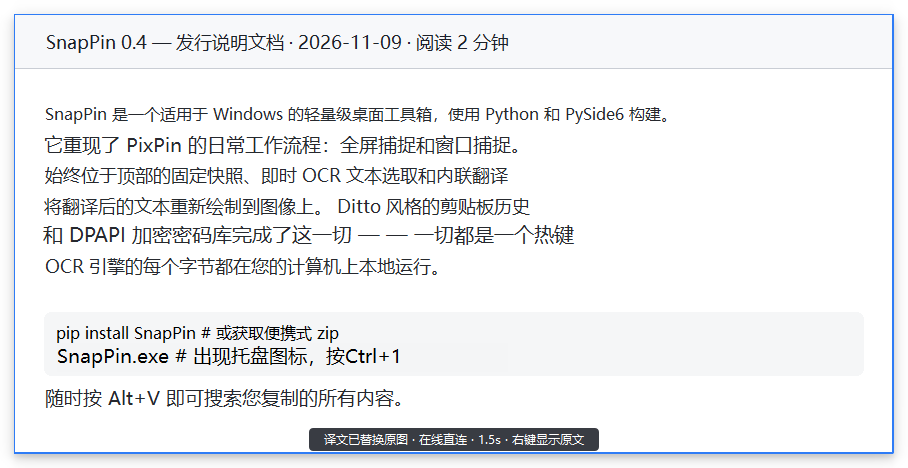
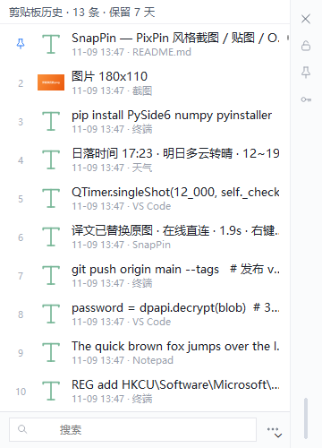
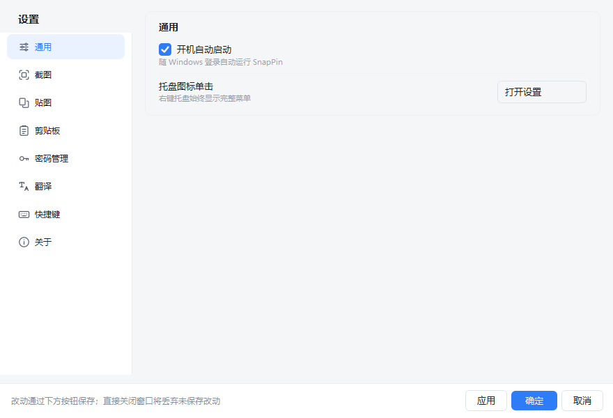

# SnapPin — PixPin 风格截图贴图工具（开源复刻）

Python + PySide6 实现的 PixPin 核心功能复刻：**截图 / 贴图 / OCR 取字 / 翻译 / Ditto 式剪贴板历史 / 密码管理**。
纯从零实现，未使用任何 PixPin 反编译产物；OCR 用 RapidAI 的开源 RapidOCR-json（PaddleOCR ONNX 模型），
翻译支持免 Key 在线直连 / GLM / MiniMax / 自定义 OpenAI 兼容 API / 本地离线引擎。

## 下载（Windows）

到 [Releases](https://github.com/shihenglong/SnapPin/releases/latest) 下载
`SnapPin-x.y.z-windows-x64.zip`（标准版）或 `SnapPin-x.y.z-full-windows-x64.zip`
（full 版，内置离线翻译插件），解压后运行 `SnapPin.exe`（免安装，绿色版）。

- 仅支持 Windows 10/11 x64。
- **升级方式**：下载新 zip 直接覆盖解压即可。所有用户数据（配置 / 剪贴板历史 /
  密码库 / 缓存）都存放在 `%APPDATA%\SnapPin`，与程序目录完全分离，替换程序不会丢数据。
- 应用内置**自动检查更新**（GitHub Releases），也可在 设置 → 关于 手动检查。

## 界面预览

| 截图与标注（选区工具栏 / 箭头 / 尺寸提示） | 贴图取字（OCR 高亮，选中字符即复制） |
|---|---|
|  |  |
| **右键翻译：译文直接替换原图文字** | **剪贴板历史（Ditto 式快贴，点哪行粘哪行）** |
|  |  |

设置窗口（8 页导航 · 应用/确定/取消 统一提交 · 关于页可检查更新）：



## 从源码运行

```bash
pip install PySide6 numpy
python main.py        # 常驻托盘；开机自启可在设置里开
```

调试模式（输出工具栏坐标/OCR 过程）：

```bash
SNAPPIN_DEBUG=1 python main.py > snappin.log 2>&1
```

## 快捷键（与 PixPin 一致，可在设置中改）

| 快捷键 | 功能 |
|---|---|
| Ctrl+1 | 截图 |
| Ctrl+Alt+V | 剪贴板贴图 |
| Alt+2 | 关闭所有贴图 |
| Ctrl+Shift+2 | 隐藏/显示所有贴图 |
| Alt+V | 剪贴板历史（Ditto 式快贴） |

所有热键集中在 设置 → 快捷键，按「截图与贴图」「剪贴板」分组修改，保存后立即生效。

## 翻译

参考 evan-ocr 的双轨方案；贴图右键「翻译（替换原图）」渲染仍为本项目实现。
全部文字块并发批量翻译，完成时 toast 以浅灰小字显示耗时：

- **在线直连（默认，免 Key 免配置）**：Google GTX 直连 + MyMemory 多通道容灾，逐块并发；
  双通道都拿不到的块自动转离线插件补齐，开箱即用。
- **Ollama（本地大模型）**：自动连接本机 Ollama（`http://localhost:11434`），
  模型自动检测（Qwen / DeepSeek 优先），0 联网请求；不可用自动转离线插件。
- **GLM API（智谱）**：`https://open.bigmodel.cn/api/paas/v4` · `glm-4.7-flash`，填 Key 即用，一次请求批量。
- **MiniMax API**：`https://api.minimaxi.com/v1` · `MiniMax-M2`。
- **自定义**：任意 OpenAI 兼容 `/chat/completions` 端点。
- **离线插件（神经翻译）**：CTranslate2 + OPUS-MT int8 模型，零网络零密钥，CPU 单批 <0.5s。
  **full 版安装包已内置**；标准版在 设置 → 翻译 → 离线插件 点「下载」（约 107MB，
  引擎包 39.7MB + en-zh 模型包 67MB），或手动解压插件包到 `vendor/plugins/translation/`。
- 目标语言支持 简体中文 / English / 日本語；所有引擎失败时最终兜底离线插件，保证可用。

## 剪贴板历史（Ditto 风格）

- **自动记录**：复制即记录，文本 / 图片 / 文件 / HTML 等所有可复制类型（保存全部剪贴板格式原始数据）。
- **快贴窗口**（`Alt+V` 或托盘菜单，Ditto 布局）：编号列表 + 底部搜索 + ••• 菜单（刷新/清空/设置）；
  **单击条目 = 粘贴**到目标窗口；右侧工具栏：✕ 关闭（Esc 同）、🔒 锁定（锁定后粘贴不关窗、
  失焦不隐藏，双击侧栏空白处同样可切换）、📌 只看常用项、🔑 密码库列表，点按切换。
- **键盘流**：输入即过滤 · `↓` 进列表 · `Enter` 粘贴当前行（密码行默认贴密码）·
  `Del` 删除 · `1`-`9` 快贴对应编号行 · `Esc` 关闭。
- **常用项**：右键「设为常用」📌 置顶且永不被清理；右键可直接删除或仅复制不粘贴。
- **密码快贴**：侧栏 🔑 列出全部条目，或在搜索框直接输入名称/账号，命中后显示「账号 / 密码」两行，
  **点哪行粘哪行**；密码默认掩码（右键「显示密码」），不会进入剪贴板历史，
  粘贴 30 秒后自动清空剪贴板。
- **存储**：SQLite（默认 `%APPDATA%\SnapPin\clip.db`，路径可在设置改）；保留天数（默认 7 天）
  与最大条数（默认 500）均可在设置调整；密码管理窗口复制的密码不会进入历史。

## 密码管理

- 名称 / 账号 / 密码三字段，手动增删改查；双击表格行快速复制密码。
- **在剪贴板历史窗口（Alt+V）搜索名称即可快贴**：账号 / 密码两行，点哪行粘哪行。
- 密码字段用 Windows DPAPI 加密（仅本机当前用户可解密），复制密码 30 秒后自动清空剪贴板。
- 数据库路径可在设置更改（默认 `%APPDATA%\SnapPin\pw.db`），保存后立即生效；
  保存/删除失败会弹窗提示，不会再无声失败。

## 交互（对齐 PixPin 实测行为）

- **截图**：全屏暗化 + 窗口吸附（跳过鼠标穿透层）+ 尺寸提示条；拖拽框选或单击选中窗口；
  选区 8 锚点可调、可拖动。
- **选区工具栏**：矩形/直线/箭头/椭圆/画笔/马克笔/颜色/马赛克/文字/橡皮擦 | 撤销/重做 |
  贴图/GIF(占位)/关闭/保存/复制。
- **标注颜色**：色板红色、绿色居前；画完一个形状后点色板，**刚画的形状立即换色**，
  所选颜色自动记忆为下次默认。
- **完成**：双击选区内外任意处 → 退出并自动进剪贴板（PixPin 行为）；Enter=复制；
  Ctrl+D=直接贴图；Esc=取消。
- **贴图即取字**：钉上后自动 OCR 全图，文字块淡蓝高亮，悬停加深，**点击文字块直接复制**；
  Shift+拖拽可重选识别区域。
- **右键翻译**：右键贴图 →「翻译（替换原图）」→ 译文直接渲染替换原图文字块（自动取背景色/
  自适应字号），即"P成中文"；「显示原文」一键切回。另有复制全部文字/复制贴图/保存/缩放/
  透明度/关闭所有贴图。
- **贴图窗口**：拖动移动、滚轮缩放（Ctrl+滚轮调透明度）、投影阴影、置顶。
- **托盘单击**：默认打开设置（可在设置改回截图/贴图）。
- **设置窗口**：左侧导航（通用/截图/贴图/剪贴板/密码管理/翻译/快捷键/关于），
  底部「应用 / 确定 / 取消」统一提交，直接关闭窗口 = 丢弃改动。

## 目录结构

```
SnapPin/
├── main.py           # 入口：单实例、托盘、热键接线、启动检查更新
├── version.py        # 版本号 + 仓库地址（发布时改）
├── updater.py        # 检查更新（GitHub Releases API）
├── capture.py        # 截图覆盖层 + 工具栏 + 标注 + 长截图
├── pinwin.py         # 贴图窗口（取字/翻译替换）
├── ocr.py            # RapidOCR-json QProcess 封装
├── translate.py      # 翻译：免 Key 直连/GLM/MiniMax/自定义 API + 本地离线引擎（批量）
├── hotkeys.py        # RegisterHotKey 全局热键线程
├── settings_ui.py    # 设置窗口（导航 + 卡片 + 确定应用取消 + 检查更新）
├── config.py         # 配置持久化（%APPDATA%\SnapPin）
├── icons.py          # 手绘 SVG 线性图标（无第三方资源）
├── clip.py           # 剪贴板监听 + SQLite 历史（全部格式）
├── clipwin.py        # Ditto 式快贴窗口
├── pwman.py          # 密码库（DPAPI 加密）
├── pwmanwin.py       # 密码管理窗口
└── vendor/plugins/   # RapidOCR-json 引擎 + 翻译引擎（发布时随包）
    ├── ocr/
    └── translation/
```

## 已知边界（MVP）

- GIF 录制按钮为占位；多屏未支持（当前取光标所在屏）；标注工具未逐一视觉回归。
- 贴图重启恢复（启动时恢复未关闭的贴图）未实现。
- 本地翻译引擎为词典型（逐词替换），追求质量请配置 GLM / MiniMax API。

## 协议

[MIT](LICENSE)
